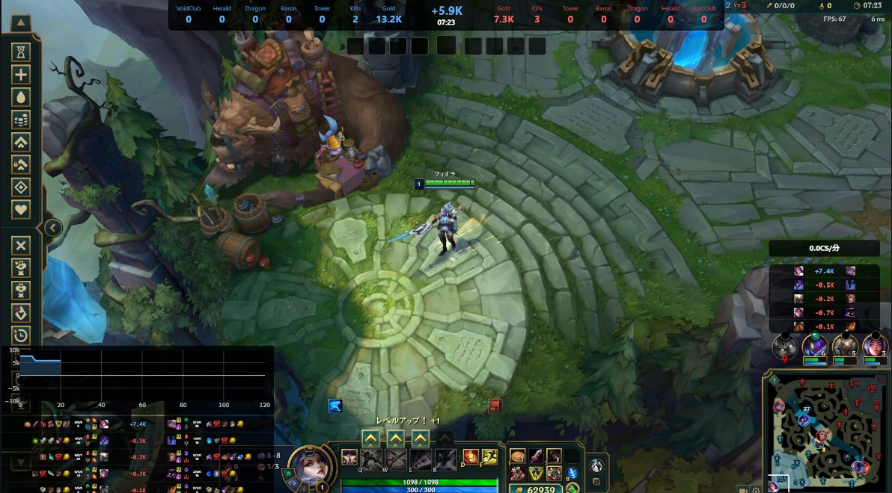

# LoL Overlay

League of Legends の Live Client Data API を利用したOBS向けオーバーレイです。

スコアボード、分間CS、ゴールドチャート、オブジェクトタイマー、スキルレベルアップ時のアイコンをリアルタイムで表示できます。




## 主な機能

- スコアボード表示
- 分間CS表示
- ゴールドチャート表示
- オブジェクトタイマー表示
- チャンピオン別スキル一覧表示
- 試合終了後のアイテム・スキルオーダー表示
- 試合終了後のサムネイル用画面表示
- チャンピオンマップ（ミニオン・タワー表示）
- スキルレベルアップ・アイテム取得時のアイコン表示
- Data Dragon画像対応
- OBSブラウザソース対応

---

## 動作環境

- Windows 10 / 11
- League of Legends
- OBS Studio

---

## ダウンロード

最新版は GitHub Releases からダウンロードしてください。


https://github.com/comaneci-lab/lol-overlay/releases

---

## セットアップ手順

### 1. ファイルを展開する

GitHub Releases からダウンロードしたZIPファイルを任意のフォルダへ展開します。

### 2. League of Legends を起動する

League of Legends クライアントを起動し、試合を開始します。

### 3. LoLAPIGet.exe を起動する

LoLAPIGet.exe を実行してください。

このプログラムは League of Legends の Live Client Data API にJavaScriptからアクセスするためのローカルプロキシです。
※JavaScriptからアクセスする場合、CORS（Cross-Origin Resource Sharing）制約によりエラーとなるため、Pythonでローカルプロキシを作成することで回避

観戦モードでは、Live Client Data APIで取得できないオブジェクト情報を画面から入力してオーバーレイに反映できます。詳しくは[観戦モードの使い方](docs/観戦モード.md)を参照してください。

#### ゲームモードごとの表示

各表示用JavaScriptの先頭付近にある `*_ALLOWED_GAME_MODES` で表示対象の `gameData.gameMode` を指定します。一覧にないモードや新しいモードでは非表示になります。観戦判定や各機能の表示タイミングなど、従来の表示条件も適用されます。

トップバーは `CLASSIC`、`PRACTICETOOL`、`SPECTATOR`、チャンピオンマップは `CLASSIC`、`PRACTICETOOL` が対象です。その他の表示機能は `CLASSIC`、`PRACTICETOOL`、`SPECTATOR` が対象で、ゴールドチャート、スコアボード、スキルレベルアップ、分間CS、試合開始スプラッシュ、試合アイテム・スキルオーダー、チャンピオンスキルには `ARAM` も含まれます。チャンピオンスキルの試合外の手動表示など、ゲームデータを取得できない場合の既存動作は維持します。

スキルレベルアップ表示では、自分のアイテムの所持数が増えてから5秒間所持し続けた場合、そのアイコンをスキルの上段に3秒間表示します。最初の取得時に所持しているアイテムは表示しません。所持品の定期比較による検知のため、購入以外の増加も対象となり、取得と取り消しが取得間隔内に完了した場合は検知できません。保持時間は `js/LoL_SkillLevelUp.js` の `ITEM_PURCHASE_HOLD_DURATION` で変更できます。

設定を変更するときはJSを別名でコピーして編集し、参照するHTMLも別名でコピーしてJSの参照先を変更してください。OBSではコピーしたHTMLのURLを指定します。公式更新でコピーが上書きされないよう、配布ファイルと重複しない名前を使用してください。

配布時の `settings.ini` は `ja_JP` に設定されています。初回起動前に、League of Legends クライアントの言語設定を確認し、異なる場合は後述の手順で `settings.ini` を変更してください。

起動すると、`LoLAPIGet.exe` と同じ場所に `json` フォルダーを作成します。JSONファイルは実行ファイルには同梱されず、オーバーレイからデータを要求されたときにData Dragonから取得し、`json\<言語コード>\` に保存します。個別チャンピオンのJSONは `/champion/<チャンピオン名>` で取得でき、`json\<言語コード>\champion\<チャンピオン名>.json` に保存されます（例: `/champion/Aatrox`）。

#### オーバーレイファイルの最新化

観戦データウィンドウの「接続・更新」タブにある「オーバーレイを最新化」から、GitHub Pagesで公開されたHTML・CSS・JavaScriptを取得できます。更新後は、変更を反映するためOBSのブラウザソースを再読み込みしてください。この操作では実行ファイル、assets、JSONは更新されません。実行ファイルはGitHub Releasesからダウンロードしてください。

起動時にPagesの公開版とローカルファイルを照合し、差分がある場合だけ最新化ボタンが有効になります。通信に失敗した場合は、ボタンから再試行できます。実行ファイルの更新確認にはPagesの`app-update.json`を使用し、ビルド元のGitコミットSHAを記録したうえで、実行中exeと公開exeのSHA-256を比較します。異なる実行ファイルが公開されている場合は該当するGitHub Releaseを案内します。実行ファイルは自動更新されません。

`build.bat`で作成した開発用exeには、更新チェックを無効にする`.dev-environment`マーカーファイルが`dist`に作成されます。ローカルで動作確認する間はそのまま使用してください。配布時は、配布用フォルダーからこのファイルを削除してからZIPを作成してください。マーカーが残っていると、利用者環境でも更新チェックが無効になります。

起動時に現在適用中のData Dragonバージョンと最新バージョンを照合し、assets・JSONが最新版なら「assets・JSONを最新化」ボタンは無効になります。ただし、設定された画像フォルダーが存在しないか空の場合は、同じバージョンでも更新できます。インストール済みバージョンが最新公開版より新しい場合は、ダウングレードを防ぐため更新できません。更新状況を取得できない場合は手動更新できるようボタンを有効にします。現在のJSON言語も「接続・更新」タブに表示します。更新ボタンは設定ファイル`config/data_dragon_assets.json`に定義した画像だけを`assets`へマージ上書きし、アーカイブにないファイルや観戦データは削除しません。JSONキャッシュは全言語分を無効化し、次回要求時に新しいバージョンから再取得します。更新後はOBSのブラウザソースを再読み込みしてください。

オーバーレイの色や配置を個別に変更する場合は、`css/custom/LoLOverlay.custom.css` を編集してください。このファイルは各オーバーレイで公式CSSの後に読み込まれ、Pagesの更新対象には含まれません。起動時の更新確認でファイルが存在しない場合は空のテンプレートを作成します。

Data Dragonのassets更新対象と展開元・配置先の対応は、`config/data_dragon_assets.json` で管理します。現在の設定は指定先へマージ上書きし、アーカイブに存在しないファイルは削除しません。独自画像を含むその他のassetsフォルダーは更新対象外です。

更新対象の公式CSSがローカルと異なる場合、上書き前に実行ファイルと同じフォルダーへ `.overlay-css-backup-*` フォルダーを作成して退避し、確認を表示します。古い公式CSSと個人編集は区別できないため、キャンセルすると更新全体を中止します（バックアップは残ります）。更新後、必要な編集内容をバックアップから `css/custom/LoLOverlay.custom.css` へ移してください。バックアップは自動削除されないため、移行を確認した後に不要なフォルダーを手動で削除できます。

GitHub Pagesへの公開は、`main` ブランチの `html/`、`css/`、`js/` の変更時と、Release公開時にGitHub Actionsで行います。Release公開時は、最新Releaseに添付された`app-update.json`をPagesへ配置します。リポジトリの「Settings」→「Pages」で、公開元を「GitHub Actions」に設定してください。

#### 使用言語の設定

ゲームクライアントの言語と `settings.ini` の `language` を一致させてください。`settings.ini` は `LoLAPIGet.exe` と同じフォルダーにあります。テキストエディターで開き、言語コードを変更して保存します。

```ini
[settings]
language = ja_JP
```

初期設定では、クライアントが日本語以外の場合、使用する言語コードに変更してください。たとえば、英語（アメリカ）クライアントの場合は次のようにします。

```ini
[settings]
language = en_US
```

使用できる言語コード（クライアントの言語に対応するコードを設定してください）：

| コード | 言語 | コード | 言語 |
| --- | --- | --- | --- |
| `cs_CZ` | チェコ語 | `el_GR` | ギリシャ語 |
| `pl_PL` | ポーランド語 | `ro_RO` | ルーマニア語 |
| `hu_HU` | ハンガリー語 | `en_GB` | 英語（イギリス） |
| `de_DE` | ドイツ語 | `es_ES` | スペイン語（スペイン） |
| `it_IT` | イタリア語 | `fr_FR` | フランス語 |
| `ja_JP` | 日本語 | `ko_KR` | 韓国語 |
| `es_MX` | スペイン語（メキシコ） | `es_AR` | スペイン語（アルゼンチン） |
| `pt_BR` | ポルトガル語（ブラジル） | `en_US` | 英語（アメリカ） |
| `en_AU` | 英語（オーストラリア） | `ru_RU` | ロシア語 |
| `tr_TR` | トルコ語 | `ms_MY` | マレー語 |
| `en_PH` | 英語（フィリピン） | `en_SG` | 英語（シンガポール） |
| `th_TH` | タイ語 | `vi_VN` | ベトナム語 |
| `id_ID` | インドネシア語 | `zh_MY` | 中国語（マレーシア） |
| `zh_CN` | 中国語（中国） | `zh_TW` | 中国語（台湾） |

言語ごとにJSONを別フォルダーへ保存するため、言語を変更しても既存のJSONキャッシュは上書きされません。

#### ゲームクライアントの言語を変更した場合

1. League of Legends クライアントの言語を変更します。
2. `settings.ini` の `language` を、新しいクライアント言語に対応するコードへ変更して保存します。
3. 起動中の `LoLAPIGet.exe` を終了し、再起動します。
4. OBSでブラウザソースを更新します。

`LoLAPIGet.exe` は起動時に `settings.ini` を読み込むため、言語設定を変更した後は再起動が必要です。

### 4. OBSにブラウザソースを追加する

OBS Studio を起動します。

「ソース」→「追加」→「ブラウザ」を選択します。

「ローカルファイル」は無効のまま、表示したい機能に対応するURLを指定してください。たとえば、トップバーとオブジェクトタイマーを別々に表示する場合は、それぞれ次のURLを指定します。

```text
http://127.0.0.1:8888/html/LoL_TopBar_Overlay.html
http://127.0.0.1:8888/html/LoL_ObjectTimer_Overlay.html
```

スコアボードを表示する場合は、次の個別HTMLを追加します。

```text
http://127.0.0.1:8888/html/LoL_Scoreboard_Overlay.html
```

チャンピオンごとのスキル情報を表示する場合は、次の個別HTMLを追加します。

```text
http://127.0.0.1:8888/html/LoL_ChampionSkills_Overlay.html
```

ゲーム外では「チャンピオン設定」からORDER／CHAOS各5ロールのチャンピオンを設定できます。検索欄で名前または英語IDを検索し、必要に応じてチャンピオン分類タグで絞り込んでください。選択内容はブラウザーに保存され、最近選択したチャンピオンも表示されます。ラインナップを全て消去する場合は「リセット」を使用してください。このボタンはゲーム外でのみ表示されます。ゲーム中は実際の試合情報が優先され、ゲーム外に戻ると保存したラインナップを表示します。

ゲーム開始時にロールごとのスプラッシュアートを表示する場合は、次の個別HTMLを追加します。

```text
http://127.0.0.1:8888/html/LoL_GameStartSplash_Overlay.html
```

ゲーム開始時にアクティブプレイヤーのルーンを10秒間表示する場合は、次の個別HTMLを追加します。

```text
http://127.0.0.1:8888/html/LoL_PlayerRunes_Overlay.html
```

試合終了後にアイテムオーダーとスキルオーダーを表示する場合は、次の個別HTMLを追加します。試合中に履歴を記録し、GameEndの検知後からLiveClientDataAPIが利用できなくなるまで表示します。完全な履歴を得るには試合開始前にソースを起動してください。途中から起動した場合、取得前のスキル順や既に所持していたアイテムは表示できません。

```text
http://127.0.0.1:8888/html/LoL_MatchOrder_Overlay.html
```

ゲーム終了後にサムネイル用の画面を表示する場合は、次の個別HTMLを追加します。上部に自分と同じロールの対面チャンピオンの `assets/centered/` の画像とそれぞれのKDA、下部に自分のルーン・シャードとスキル・アイテムオーダーを表示し、勝敗表示が見えるよう中央を透過します。`assets/centered/` の画像は「assets・JSONを最新化」で更新されます。ゲーム画面の上にブラウザソースを重ねてください。GameEnd検知後に表示し、Live Client Data APIからデータを取得できなくなると非表示になります。試合開始前にソースを起動すると、オーダーをより完全に記録できます。記録がリセットされないよう、このソースではOBSの「表示されていない時にソースをシャットダウンする」と「シーンがアクティブになったときにブラウザを更新する」を無効にしてください。

```text
http://127.0.0.1:8888/html/LoL_PostGameThumbnail_Overlay.html
```

個別HTMLは機能ごとに分かれているため、必要なものをそれぞれブラウザソースとして追加してください。HTMLと推奨サイズ、OBSの設定手順は[OBS設定手順](docs/OBS設定手順.md)を参照してください。オーバーレイHTMLは `html/`、全ページ共通のCSSは `css/LoLOverlay.css`、ページ固有のCSSは `css/individual/`、JavaScriptは `js/` にあります。これらのファイルを編集した後は、ブラウザソースを更新すると変更が反映されます。Chromeで確認するときも、HTMLファイルを直接開かず、同じ `http://127.0.0.1:8888/html/...` のURLを使用してください。

複数の表示をまとめた全体オーバーレイも利用できます。設定方法が個別HTMLより複雑なため、初めて使う場合は個別HTMLをおすすめします。横型・縦型の全体オーバーレイの設定は[横型・縦型オーバーレイの設定](docs/横型・縦型オーバーレイ.md)を参照してください。

### 5. ゲームを開始する

試合開始後、自動的にオーバーレイが更新されます。

### 6. 表示機能のカスタマイズ

横型・縦型の個別機能の表示・非表示を切り替える方法は、[全体オーバーレイの設定ガイド](docs/横型・縦型オーバーレイ.md)を参照してください。

---

## 終了方法

### オーバーレイを終了する

観戦データ入力画面を閉じてください。これによりLoLAPIGet.exeとローカルプロキシが終了します。

またはコンソールウィンドウで

```text
Ctrl + C
```

を実行しても閉じれます。

### OBSを終了する

通常どおり OBS Studio を終了してください。

---

## トラブルシューティング

### 情報が表示されない

以下をご確認ください。

- League of Legends の試合中である
- LoLAPIGet.exe が起動している
- OBS が正しいHTMLファイルを参照している

### アイコンが表示されない

一部のチャンピオンアイコンやサモナースペルだけ表示されない場合は、まず `settings.ini` の `language` がLeague of Legends クライアントの言語と一致しているか確認してください。異なる場合は正しい言語コードへ変更し、`LoLAPIGet.exe` を再起動してから、OBSのブラウザソースを更新してください。

あわせて、Releaseに含まれている画像ファイルが削除されていないか確認してください。

またはDataDragonから最新の画像を取得してください。
https://developer.riotgames.com/docs/lol

または、各種jsonを削除・再実行し、最新のjsonを反映させてください。

---

## 不具合報告・要望

不具合報告や機能要望は GitHub Issues よりお願いします。

---

## 開発ブログ

開発の記録や技術解説を公開しています。

https://do-something.jp/

---

## Author

comaneci

GitHub:
https://github.com/comaneci-lab

Blog:
https://do-something.jp/

---

## Disclaimer

LoL Overlay は Riot Games によって承認、スポンサー、または提携されたものではありません。

League of Legends および関連するアセットの権利は Riot Games に帰属します。

---

## License

This project is licensed under the MIT License.

See the LICENSE file for details.

---

## 実行ファイルのビルド

Python と PyInstaller をインストールした Windows 環境で、プロジェクトのルートにある `build.bat` を実行してください。

事前に `python -m pip install -r requirements.txt` で実行時の依存パッケージをインストールしてください。OBS連携には `obs-websocket-py`、Windows資格情報マネージャーには `pywin32-ctypes` が必要です。

起動時に開発版またはリリース版を選択します。開発版はタグの有無にかかわらず「開発版」と表示され、Releaseとのバージョン比較は行いません。リリース版では `v0.7.1` のようなタグ名を入力すると、現在のコミットにローカルタグを作成します。同じコミットに既存のタグがある場合は再利用できます。未コミットの変更がある場合や、同名タグが別のコミットにある場合は中止します。

タグは自動でpushされません。ビルド後にコミットとタグをGitHubへpushしてください（例: `git push origin main`、`git push origin v0.7.1`）。ビルドが失敗した場合も作成済みのローカルタグは残り、同じコミットで再実行できます。

`build.bat`は、リリース版の場合に実行ファイルのバージョン・コミットSHA・SHA-256を含む`dist\app-update.json`を生成します。配布ZIPには同じビルドで生成されたexeを含めてください。GitHub Releaseを公開する前に、配布ZIPとこのJSONをそれぞれRelease assetとして添付してください。JSONのasset名は`app-update.json`にしてください。Release公開後、GitHub ActionsがJSONをGitHub Pagesへ反映します。JSONが添付されていないReleaseはPagesへの公開が失敗します。開発版では古いJSONが誤用されないよう、`app-update.json`は生成されません。

```text
dist\LoLAPIGet.exe
```

に単一ファイル形式の実行ファイルが生成されます。観戦データGUIで使うドラゴン画像6枚は実行ファイルに含まれるため、GUI表示のために `assets` フォルダーを実行ファイルの隣へ置く必要はありません。実行時に `_internal` フォルダも不要です。HTMLオーバーレイが使う画像やHTML、CSS、JavaScriptは、これまでどおり実行ファイルとは別に配置してください。

JSONデータは実行ファイルに含まれません。実行時に、`settings.ini` で指定された言語のデータを必要に応じてData Dragonから取得します。
