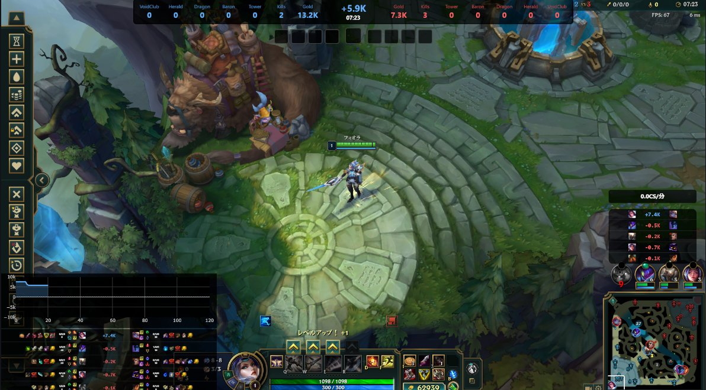

# LoL Overlay

League of Legends の Live Client Data API を利用したOBS向けオーバーレイです。

スコアボード、分間CS、ゴールドチャート、オブジェクトタイマー、スキルレベルアップ時のアイコンをリアルタイムで表示できます。




## 主な機能

- スコアボード表示
- 分間CS表示
- ゴールドチャート表示
- オブジェクトタイマー表示
- スキルレベルアップ時のアイコン表示
- Data Dragon画像対応
- OBSブラウザソース対応

---

## 動作環境

- Windows 10 / 11
- League of Legends
- OBS Studio

---

## ダウンロード

最新版は GitHub Releases からダウンロードしてください。


https://github.com/comaneci-lab/lol-overlay/releases

---

## セットアップ手順

### 1. ファイルを展開する

GitHub Releases からダウンロードしたZIPファイルを任意のフォルダへ展開します。

### 2. League of Legends を起動する

League of Legends クライアントを起動し、試合を開始します。

### 3. LoLAPIGet.exe を起動する

LoLAPIGet.exe を実行してください。

このプログラムは League of Legends の Live Client Data API にJavaScriptからアクセスするためのローカルプロキシです。
※JavaScriptからアクセスする場合、CORS（Cross-Origin Resource Sharing）制約によりエラーとなるため、Pythonでローカルプロキシを作成することで回避

観戦モードでは、Live Client Data APIで取得できないオブジェクト情報を画面から入力してオーバーレイに反映できます。詳しくは[観戦モードの使い方](docs/観戦モード.md)を参照してください。

配布時の `settings.ini` は `ja_JP` に設定されています。初回起動前に、League of Legends クライアントの言語設定を確認し、異なる場合は後述の手順で `settings.ini` を変更してください。

起動すると、`LoLAPIGet.exe` と同じ場所に `json` フォルダーを作成します。JSONファイルは実行ファイルには同梱されず、オーバーレイからデータを要求されたときにData Dragonから取得し、`json\<言語コード>\` に保存します。

#### 使用言語の設定

ゲームクライアントの言語と `settings.ini` の `language` を一致させてください。`settings.ini` は `LoLAPIGet.exe` と同じフォルダーにあります。テキストエディターで開き、言語コードを変更して保存します。

```ini
[settings]
language = ja_JP
```

初期設定では、クライアントが日本語以外の場合、使用する言語コードに変更してください。たとえば、英語（アメリカ）クライアントの場合は次のようにします。

```ini
[settings]
language = en_US
```

使用できる言語コード（クライアントの言語に対応するコードを設定してください）：

| コード | 言語 | コード | 言語 |
| --- | --- | --- | --- |
| `cs_CZ` | チェコ語 | `el_GR` | ギリシャ語 |
| `pl_PL` | ポーランド語 | `ro_RO` | ルーマニア語 |
| `hu_HU` | ハンガリー語 | `en_GB` | 英語（イギリス） |
| `de_DE` | ドイツ語 | `es_ES` | スペイン語（スペイン） |
| `it_IT` | イタリア語 | `fr_FR` | フランス語 |
| `ja_JP` | 日本語 | `ko_KR` | 韓国語 |
| `es_MX` | スペイン語（メキシコ） | `es_AR` | スペイン語（アルゼンチン） |
| `pt_BR` | ポルトガル語（ブラジル） | `en_US` | 英語（アメリカ） |
| `en_AU` | 英語（オーストラリア） | `ru_RU` | ロシア語 |
| `tr_TR` | トルコ語 | `ms_MY` | マレー語 |
| `en_PH` | 英語（フィリピン） | `en_SG` | 英語（シンガポール） |
| `th_TH` | タイ語 | `vi_VN` | ベトナム語 |
| `id_ID` | インドネシア語 | `zh_MY` | 中国語（マレーシア） |
| `zh_CN` | 中国語（中国） | `zh_TW` | 中国語（台湾） |

言語ごとにJSONを別フォルダーへ保存するため、言語を変更しても既存のJSONキャッシュは上書きされません。

#### ゲームクライアントの言語を変更した場合

1. League of Legends クライアントの言語を変更します。
2. `settings.ini` の `language` を、新しいクライアント言語に対応するコードへ変更して保存します。
3. 起動中の `LoLAPIGet.exe` を終了し、再起動します。
4. OBSでブラウザソースを更新します。

`LoLAPIGet.exe` は起動時に `settings.ini` を読み込むため、言語設定を変更した後は再起動が必要です。

### 4. OBSにブラウザソースを追加する

OBS Studio を起動します。

「ソース」→「追加」→「ブラウザ」を選択します。

「ローカルファイル」を有効にし、表示したい機能に対応する個別HTMLを指定してください。たとえば、トップバーとオブジェクトタイマーを別々に表示する場合は、それぞれ次のファイルを選びます。

```text
html\LoL_TopBar_Overlay.html
html\LoL_ObjectTimer_Overlay.html
```

スコアボードを表示する場合は、次の個別HTMLを追加します。

```text
C:\LoLOverlay\html\LoL_Scoreboard_Overlay.html
```

個別HTMLは機能ごとに分かれているため、必要なものをそれぞれブラウザソースとして追加してください。HTMLと推奨サイズ、OBSの設定手順は[OBS設定手順](docs/OBS設定手順.md)を参照してください。オーバーレイHTMLは `html/`、全ページ共通のCSSは `css/LoLOverlay.css`、ページ固有のCSSは `css/individual/` にあります。

複数の表示をまとめた全体オーバーレイも利用できます。設定方法が個別HTMLより複雑なため、初めて使う場合は個別HTMLをおすすめします。横型・縦型の全体オーバーレイの設定は[横型・縦型オーバーレイの設定](docs/横型・縦型オーバーレイ.md)を参照してください。

### 5. ゲームを開始する

試合開始後、自動的にオーバーレイが更新されます。

### 6. 表示機能のカスタマイズ

横型・縦型の個別機能の表示・非表示を切り替える方法は、[全体オーバーレイの設定ガイド](docs/横型・縦型オーバーレイ.md)を参照してください。

---

## 終了方法

### オーバーレイを終了する

観戦データ入力画面を閉じてください。これによりLoLAPIGet.exeとローカルプロキシが終了します。

またはコンソールウィンドウで

```text
Ctrl + C
```

を実行しても閉じれます。

### OBSを終了する

通常どおり OBS Studio を終了してください。

---

## トラブルシューティング

### 情報が表示されない

以下をご確認ください。

- League of Legends の試合中である
- LoLAPIGet.exe が起動している
- OBS が正しいHTMLファイルを参照している

### アイコンが表示されない

一部のチャンピオンアイコンやサモナースペルだけ表示されない場合は、まず `settings.ini` の `language` がLeague of Legends クライアントの言語と一致しているか確認してください。異なる場合は正しい言語コードへ変更し、`LoLAPIGet.exe` を再起動してから、OBSのブラウザソースを更新してください。

あわせて、Releaseに含まれている画像ファイルが削除されていないか確認してください。

またはDataDragonから最新の画像を取得してください。
https://developer.riotgames.com/docs/lol

または、各種jsonを削除・再実行し、最新のjsonを反映させてください。

---

## 不具合報告・要望

不具合報告や機能要望は GitHub Issues よりお願いします。

---

## 開発ブログ

開発の記録や技術解説を公開しています。

https://do-something.jp/

---

## Author

comaneci

GitHub:
https://github.com/comaneci-lab

Blog:
https://do-something.jp/

---

## Disclaimer

LoL Overlay は Riot Games によって承認、スポンサー、または提携されたものではありません。

League of Legends および関連するアセットの権利は Riot Games に帰属します。

---

## License

This project is licensed under the MIT License.

See the LICENSE file for details.

---

## 実行ファイルのビルド

Python と PyInstaller をインストールした Windows 環境で、プロジェクトのルートにある `build.bat` を実行してください。

```text
dist\LoLAPIGet.exe
```

に単一ファイル形式の実行ファイルが生成されます。観戦データGUIで使うドラゴン画像6枚は実行ファイルに含まれるため、GUI表示のために `assets` フォルダーを実行ファイルの隣へ置く必要はありません。実行時に `_internal` フォルダも不要です。HTMLオーバーレイが使う画像やHTML、CSS、JavaScriptは、これまでどおり実行ファイルとは別に配置してください。

JSONデータは実行ファイルに含まれません。実行時に、`settings.ini` で指定された言語のデータを必要に応じてData Dragonから取得します。
