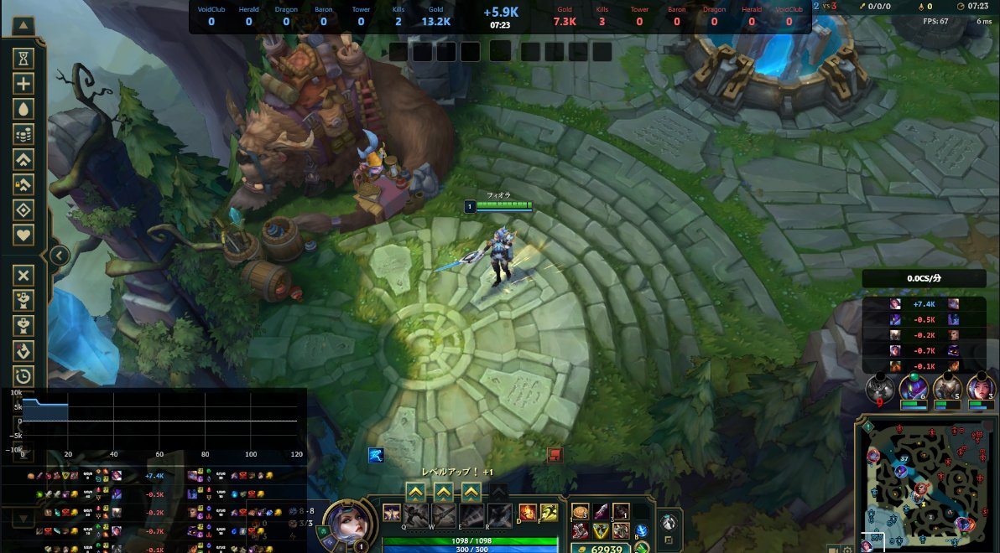

# LoL Overlay

League of Legends の Live Client Data API を利用したOBS向けオーバーレイです。

スコアボード、分間CS、ゴールドチャート、オブジェクトタイマーをリアルタイムで表示できます。




## 主な機能

- スコアボード表示
- 分間CS表示
- ゴールドチャート表示
- オブジェクトタイマー表示
- Data Dragon画像対応
- OBSブラウザソース対応

---

## 動作環境

- Windows 10 / 11
- League of Legends
- OBS Studio

---

## ダウンロード

最新版は GitHub Releases からダウンロードしてください。


https://github.com/comaneci-lab/lol-overlay/releases

---

## セットアップ手順

### 1. ファイルを展開する

GitHub Releases からダウンロードしたZIPファイルを任意のフォルダへ展開します。

### 2. League of Legends を起動する

League of Legends クライアントを起動し、試合を開始します。

### 3. LoLAPIGet.exe を起動する

LoLAPIGet.exe を実行してください。

このプログラムは League of Legends の Live Client Data API にJavaScriptからアクセスするためのローカルプロキシです。
※JavaScriptからアクセスする場合、CORS（Cross-Origin Resource Sharing）制約によりエラーとなるため、Pythonでローカルプロキシを作成することで回避

正常に起動するとコンソールウィンドウが表示されます。
初回起動時には、`LoLAPIGet.exe` と同じ場所に空の `json` フォルダーを作成します。オーバーレイが各データを要求すると、必要なJSONファイルをData Dragonから取得してこのフォルダーに保存します。JSONファイルは実行ファイルには同梱されません。

### 4. OBSにブラウザソースを追加する

OBS Studio を起動します。

「ソース」→「追加」→「ブラウザ」を選択します。

「ローカルファイル」を有効にし、以下のファイルを指定してください。

```text
LoL_Overlay_Landscape.html
```

例:

```text
C:\LoLOverlay\LoL_Overlay_Landscape.html
```

詳しい手順は[OBS設定手順](docs/OBS設定手順.md)を参照してください。

### 5. 表示サイズと位置を初期設定する

オーバーレイのキャンバスサイズは、OBSで使う映像の向き・解像度に合わせてください。初期設定は横型が **1920×1080**、縦型が **1080×1920** です。横型を使う場合は `LoL_Overlay_Landscape.html`、縦型を使う場合は `LoL_Overlay_Portrait.html` を編集します。

#### OBSのサイズを合わせる

1. OBSの「設定」→「映像」で、基本（キャンバス）解像度を配信・録画で使うサイズに設定します。
2. 「ソース」のブラウザーソースのプロパティを開き、「幅」「高さ」をその解像度に合わせます。
3. HTMLのキャンバスサイズも同じ幅・高さにします。HTMLをテキストエディターで開き、`<head>` 内の `<style>` にある `:root` に、次の2項目を追加または変更します。

```css
--canvas-width: 1920px;
--canvas-height: 1080px;
```

たとえば縦型の標準サイズにする場合は、幅を `1080px`、高さを `1920px` にします。横型・縦型の初期サイズをそのまま使う場合は、HTMLのキャンバスサイズを変更する必要はありません。映像サイズを変更したときは、OBSの基本（キャンバス）解像度、ブラウザーソースの幅・高さ、HTMLのキャンバスサイズの3つを揃えてください。

#### 各表示の位置・大きさを調整する

同じ `<style>` 内の `:root` にある値を変更すると、ウィジェットごとの位置や拡大率を調整できます。

| 設定項目 | 調整できる内容 |
| --- | --- |
| `--topbar-top`、`--topbar-left`、`--topbar-scale` | トップバーの上下・左右位置と拡大率 |
| `--gold-chart-left`、`--gold-chart-bottom`、`--gold-chart-scale` | ゴールドグラフの左右・下位置と拡大率 |
| `--scoreboard-left`、`--scoreboard-bottom`、`--scoreboard-scale` | スコアボードの左右・下位置と拡大率 |
| `--role-gold-diff-top`、`--role-gold-diff-right`、`--role-gold-diff-scale` | 横型のレーン別ゴールド差の上・右位置と拡大率 |
| `--active-player-cs-top`、`--active-player-cs-right`、`--active-player-cs-scale` | 横型の分間CSの上・右位置と拡大率 |
| `--object-timer-top`、`--object-timer-right`、`--object-timer-scale` | オブジェクトタイマーの上・右位置と拡大率 |

位置は `px` 単位で調整します。拡大率は単位なしで、`1` が標準、`1.2` が1.2倍、`0.8` が0.8倍です。スコアボードの横幅を変える場合は `--scoreboard-width` と `--scoreboard-display-width` も調整してください。

横型と縦型は別のHTMLファイルなので、両方使う場合はそれぞれを編集します。調整後はファイルを保存し、OBSでブラウザーソースを再読み込みして表示位置や見切れがないか確認してください。

### 6. ゲームを開始する

試合開始後、自動的にオーバーレイが更新されます。

### 7. 表示機能のカスタマイズ

LoL_Overlay_Landscape.htmlの表示・非表示を変更したい場合は以下を参考にしてください。

- [表示機能の切り替え方法](docs/個別JSの追加と削除.md)

---

## 終了方法

### オーバーレイを終了する

LoLAPIGet.exe のウィンドウを閉じてください。

またはコンソールウィンドウで

```text
Ctrl + C
```

を実行しても閉じれます。

### OBSを終了する

通常どおり OBS Studio を終了してください。

---

## トラブルシューティング

### 情報が表示されない

以下をご確認ください。

- League of Legends の試合中である
- LoLAPIGet.exe が起動している
- OBS が正しいHTMLファイルを参照している

### アイコンが表示されない

Releaseに含まれている画像ファイルが削除されていないか確認してください。

またはDataDragonから最新の画像を取得してください。
https://developer.riotgames.com/docs/lol

または、各種jsonを削除・再実行し、最新のjsonを反映させてください。

---

## 不具合報告・要望

不具合報告や機能要望は GitHub Issues よりお願いします。

---

## 開発ブログ

開発の記録や技術解説を公開しています。

https://do-something.jp/

---

## Author

comaneci

GitHub:
https://github.com/comaneci-lab

Blog:
https://do-something.jp/

---

## Disclaimer

LoL Overlay は Riot Games によって承認、スポンサー、または提携されたものではありません。

League of Legends および関連するアセットの権利は Riot Games に帰属します。

---

## License

This project is licensed under the MIT License.

See the LICENSE file for details.

---

## 実行ファイルのビルド

Python と PyInstaller をインストールした Windows 環境で、プロジェクトのルートにある `build.bat` を実行してください。

```text
dist\LoLAPIGet.exe
```

に単一ファイル形式の実行ファイルが生成されます。実行時に `_internal` フォルダは不要です。HTML、CSS、JavaScript、画像などのオーバーレイファイルは、これまでどおり実行ファイルとは別に配置してください。

ビルド時に `json` フォルダがある場合はJSONデータも実行ファイルに含まれます。ない場合は、従来どおり実行時にデータを取得します。
